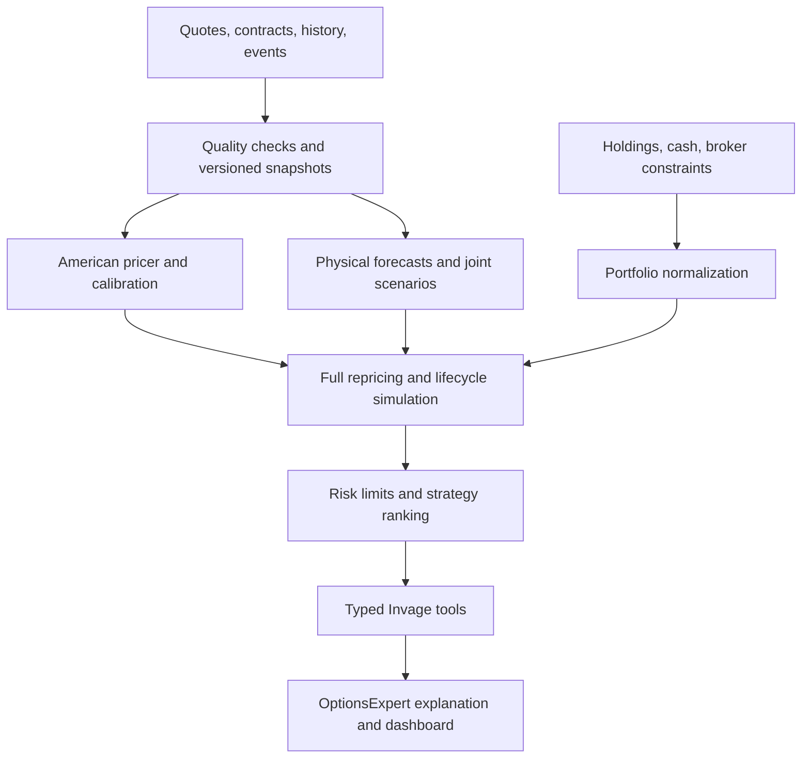

# US equity and ETF options: risk models, strategy selection, and simulation

Research date: 2026-10-16. Scope: listed US stock and ETF puts/calls, existing holdings and candidate strategies. Prepared for Invage. This is a research and implementation design; no models have been fitted, backtested, or deployed as part of this document. Numerical examples are hypothetical.

## 1. Recommendation

Build a **portfolio scenario engine with American-option repricing and expected-shortfall constraints**. Use separate models for market valuation and real-world forecasting. A single Black–Scholes, Heston, or machine-learning model does not solve valuation, future returns, assignment, liquidity, and strategy selection together.

Recommended progression:

1. **Usable first release:** observed option quotes, a dividend-aware American finite-difference pricer, Greeks, exact expiry payoffs, historical joint scenarios, full portfolio repricing, deterministic stress tests, assignment funding checks, and ranked hold/close/hedge alternatives.
2. **Forecast extension:** filtered historical simulation (FHS), with a GJR-GARCH Student-t model as a challenger; jointly model underlying returns and changes in implied-volatility surface factors. Publish forecast intervals and calibration results.
3. **Strategy engine:** enumerate permitted strategies and integer sizes; evaluate incremental portfolio effects; rank using net expected P/L, expected shortfall (ES/CVaR), funding, liquidity, and model disagreement. Include doing nothing.
4. **Advanced challenger:** Heston stochastic volatility and explicit event jumps, only after demonstrating better out-of-sample results than simpler models.

Practical stack: **QuantLib + Python numerical tooling + arch**, behind a typed service invoked by Invage's TypeScript tools. Add **CVXPY** when enumeration becomes inadequate. Recommendations and thresholds below are design judgments, not findings that these models will generate profitable trades.

## 2. What “predict the future” should mean

The useful output is a conditional distribution: possible stock prices, option values, portfolio losses, funding needs, and their estimated probabilities at a stated horizon. It is not a guaranteed future price.

Keep three products distinct:

| Product | Inputs and interpretation | Appropriate use |
|---|---|---|
| Risk-neutral valuation, Q | Prices calibrated to current option quotes and financing assumptions | Price consistency, Greeks, market-implied scenarios |
| Physical forecast, P | Historical returns, volatility dynamics, events, and validated predictors | Estimated realized P/L, probability of profit, portfolio risk |
| Stress scenarios | Explicit shocks chosen by the analyst | Survival and funding assessment; no probability unless separately justified |

Option-implied probabilities embed risk premia. They cannot simply be labeled actual probabilities. Federal Reserve research explains this distinction and shows why crash forecasting from option prices remains difficult. [Federal Reserve crash forecasting research](https://www.federalreserve.gov/econresdata/notes/feds-notes/2014/forecasting-stock-market-crashes-is-hard-especially-future-ones-20140507.html)

Likewise, delta is a hedge sensitivity, not a universal probability of profit. Even in the European Black–Scholes setting, call delta and the risk-neutral expiry ITM probability differ. Profit also depends on premium, costs, exits, and other legs.

Suggested horizons: 1 and 5 trading days for risk; 21 trading days and actual expiry for strategy evaluation. Track trading-day simulation steps separately from calendar-time option decay. A daily model is insufficient for 0DTE monitoring; exclude that use from the initial release.

## 3. Candidate models and selection

| Model or method | Useful capability | Principal weakness | Decision |
|---|---|---|---|
| Black–Scholes–Merton / GBM | Fast baseline valuation and transparent sensitivities | Constant volatility/lognormal assumptions; European exercise | Benchmark and sanity checks |
| Binomial tree / finite differences | American exercise, dividend treatment, numerical Greeks | Accuracy depends on grid, dividend model, and volatility assumptions | Core production pricing method after validation |
| Constrained SVI/SSVI surface | Smooth strike/expiry smile and static-arbitrage controls | Surface fit is not a model of future returns | Later surface layer where chain density supports it |
| Historical simulation | Interpretable actual joint shocks | Limited history, regime dependence, missing unprecedented shocks | First scenario baseline |
| Filtered historical simulation | Scales historical residual shocks to current volatility | Filter and residual sampling choices affect tails | Preferred initial probabilistic engine |
| GJR-GARCH with Student-t innovations | Volatility persistence, asymmetric shocks, heavy tails | Parameter instability; limited structural/event insight | Forecast challenger and possible FHS filter |
| HAR realized-volatility regression | Daily/weekly/monthly volatility persistence | Needs reliable realized-volatility data; not a directional model | Optional challenger with intraday history |
| Heston stochastic volatility | Correlated price/variance dynamics, smile-aware pricing | Calibration ambiguity; no jumps in basic model; Q parameters do not identify P | Phase 3 challenger |
| Jump diffusion / stochastic volatility with jumps | Earnings gaps and discontinuities | Sparse event samples and difficult calibration | Explicit event overlay before full model |
| Local volatility | Fits a vanilla surface under assumptions | Future smile dynamics can be unrealistic | Specialized challenger, not default forecast |
| Regime switching | Different calm/stressed dynamics | Regimes inferred with error; hindsight bias | Later, only with causal state estimates |
| Neural networks / transformers / reinforcement learning | Flexible nonlinear features or policies | Data hunger, leakage, instability, weak auditability | Research only until incremental value demonstrated |

These are different categories: finite differences is a numerical pricing method; Monte Carlo is a simulation method; ES is a risk measure; Heston and GARCH specify stochastic dynamics. Combining them is normal.

Heston's original result concerns European option valuation under stochastic volatility; US equity use still needs an American exercise method. [Heston original paper](https://wwwf.imperial.ac.uk/~ajacquie/IC_Num_Methods/IC_Num_Methods_Docs/Literature/Heston.pdf)

Gatheral and Jacquier provide conditions for static-arbitrage-free SVI surfaces. For American quotes, do not apply European surface constraints or density extraction directly: first estimate consistent European-equivalent prices using an American model, quantify the adjustment error, and reject unstable regions. [Gatheral and Jacquier](https://arxiv.org/abs/1204.0646)

## 4. Market data is the main prerequisite

### Required datasets

| Dataset | Required fields | Why |
|---|---|---|
| Contract master | Stable contract ID, right, strike, expiration timestamp/timezone, exercise style, multiplier, deliverable, settlement | Correct payoff and corporate-action handling |
| Quote snapshots | Bid/ask, sizes if available, timestamps, venue/feed, underlying timestamp | Executable economics and stale-data rejection |
| Underlying history | Raw prices, splits, cash dividends, trading calendar | Return estimation and dividend-aware simulation |
| Historical option chains | Point-in-time available strikes/expiries, quotes, identifiers | Surface dynamics and realistic backtests |
| Events | Earnings announcement timestamp, expected/confirmed status, dividends, corporate actions | Jump and assignment scenarios |
| Rates and borrow | Maturity-matched discount inputs, dividend estimates, borrow availability/cost where relevant | Carry and short-stock funding |
| Holdings and cash | Signed contracts, shares, account, basis, fills, cash, collateral | Portfolio-level recommendations |
| Broker constraints | Permission level, buying power, house margin, exercise cutoffs | Feasible strategy and funding checks |

Use split-adjusted returns and explicit dividends consistently. Do not simulate a dividend-adjusted total-return series and subtract dividends again. Store raw execution-time prices separately from adjusted research series. Contract multipliers are often 100 but must come from metadata; adjusted deliverables can include shares and cash.

### Usable data sources

- **Existing Yahoo integration:** useful for discovery and indicative snapshots. The inspected Invage code explicitly treats absent Greeks as unavailable. It is not evidence that historical bid/ask chains, synchronized quotes, or complete corporate-action metadata are available.
- **Cboe DataShop Option EOD Summary:** a candidate for historical chain research; its product page describes EOD quotes and optional IV/Greeks. Confirm purchased fields, timestamps, symbols, and coverage with sample files before committing. EOD data cannot validate intraday execution or stops. [Cboe product specification](https://datashop.cboe.com/option-eod-summary)
- **Cboe volatility surfaces:** candidate historical surface input; evaluate provenance and whether the surface methodology matches the intended pricing conventions. [Cboe surface product](https://datashop.cboe.com/volatility-surfaces)
- **Databento equity-options data:** candidate for granular OPRA history and timestamped definitions. Evaluate feed volume, normalization, retention, and entitlement requirements. Do not assume a quote feed includes every required event or forecast input. [Official options documentation](https://www.databento.tech/docs/examples/options/equity-options-introduction)
- **Broker feeds:** preferred source for account holdings, permissions, buying power, and execution context. Validate each broker independently rather than treating analytics margin as authoritative.

No current vendor prices or entitlements were established in this research. Obtain small sample datasets and a cost estimate for the intended universe, history, and refresh frequency.

### Quality gates

Reject crossed markets, invalid prices, unknown deliverables, materially asynchronous underlying/option quotes, and expired contracts. Flag zero bids and large spreads; last trade alone is not an executable mark. Define freshness by session and liquidity tier. Persist raw inputs, rejection reasons, source versions, and fallback decisions.

Use mid prices for clearly labeled valuation diagnostics. For candidate trades, start with buying at ask and selling at bid, plus fees; compare less conservative fill models only when supported by actual fills. OI and volume are context, not guarantees of current fillability.

## 5. Valuation and portfolio risk

### American pricing

US equity and ETF options generally permit early exercise and physically settle, so exercise and resulting stock positions must be represented. Read actual contract specifications rather than inferring them from the ticker alone. [OCC/OIC exercise guidance](https://www.optionseducation.org/referencelibrary/faq/options-exercise)

Use QuantLib's dividend-aware finite-difference Black–Scholes engine as the initial numerical implementation. Its source exposes dividend-schedule and cash-dividend-model choices. Select and pin a tested version; verify the exact Python binding signature before implementation. [QuantLib engine source](https://github.com/lballabio/QuantLib/blob/master/ql/pricingengines/vanilla/fdblackscholesvanillaengine.hpp)

Initial calibration: solve each sufficiently liquid contract's implied volatility using the same American engine, rates, and dividends used for repricing. This yields consistent per-contract marks but is not a complete arbitrage-free dynamic surface. Use conservative interpolation only over supported regions; do not manufacture a precise far-wing surface from thin quotes.

Calculate delta, gamma, vega, theta, and rho through tested engine outputs or bump-and-reprice. Record conventions: vega per one volatility percentage point, theta per calendar day, rates in decimal units. Add vanna/volga when smile risk warrants it. Compare frozen-IV and surface-adjusted sensitivities; label them.

### Full repricing

For signed contracts n_i, multiplier m_i, and per-share option value V_i:

```text
option value = sum_i n_i * m_i * V_i
portfolio value = option value + stock value + cash - liabilities
scenario P/L = ending net liquidation wealth - starting net liquidation wealth
```

The wealth ledger must include initial trade cash flows, commissions, financing, dividends, exercise cash, delivered shares, and closeout costs exactly once. Maintain separate lifetime trade P/L and forward P/L from today's decision point. Never improve a proposed roll by hiding the loss on its closing leg.

Greeks explain local moves. Full repricing determines scenario risk when spot moves substantially, volatility/skew shifts, time passes, or exercise occurs. Sum underlying-specific sensitivities carefully: raw deltas across unrelated stocks are not a meaningful portfolio hedge ratio. Report dollar delta and factor/beta exposure separately.

### Risk dashboard

Report by account, underlying, strategy group, expiry, sector/factor, and total portfolio:

- Current value, cost basis, realized/unrealized P/L, and data coverage.
- Dollar delta, gamma exposure, vega by maturity, daily theta, and concentration.
- 95% and 99% VaR, 97.5% and 99% ES, with horizon, model, and sampling uncertainty.
- Exact expiry maximum loss where finite; otherwise explicitly unbounded or unavailable.
- Historical and hypothetical stress losses, liquidity cost, assignment cash/share requirements.
- Minimum projected cash and broker buying-power headroom along each path.

For loss L, VaR_a is its a-quantile. Define ES robustly as the average of the worst (1-a) fraction, using fractional scenario weights at the boundary. Equivalently:

```text
ES_a(L) = min_z [ z + E[max(L - z, 0)] / (1 - a) ]
```

This handles atoms in payoff distributions more accurately than blindly averaging all losses greater than or equal to VaR. CVXPY provides a sample CVaR atom. [CVXPY CVaR implementation](https://www.cvxpy.org/_modules/cvxpy/atoms/cvar.html)

The 97.5% reporting level is a design choice, informed by established market-risk practice; this project is not implementing a bank regulatory-capital model. [BIS market-risk framework](https://www.bis.org/committees/bcbs/basel-framework/standard/mar?allChapters=true)

ES is model-dependent, not a worst-case guarantee. Portfolio ES must be computed from joint losses; summing standalone ES misses diversification and common-tail behavior.

## 6. Forecast and scenario engine

### 6.1 Filtered historical simulation

Proposed implementation:

1. Estimate conditional volatility for underlying returns using an EWMA baseline, then compare GJR-GARCH.
2. Standardize historical shocks using volatility estimates available at each historical date.
3. Preserve cross-asset dependence by sampling synchronized residual vectors; use blocks where serial dependence matters.
4. Include same-date changes in surface level, skew, and term structure where history exists. Condition their scale/dynamics on current state.
5. Generate future return paths, reconstruct positive spot prices, apply corporate actions consistently, update variance and surface factors, and reprice options at each horizon.
6. Apply the strategy's explicit exercise/exit/rebalance policy and maintain cash/stock ledgers.

Bootstrap residuals can reflect empirical shocks, but cannot create every unseen crisis. Separate deterministic stresses remain mandatory. If historical surface changes are missing, report a matrix of fixed/skew/IV shocks as conditional scenarios; do not claim a calibrated probability distribution for interim option P/L.

### 6.2 GJR-GARCH Student-t challenger

A daily log-return specification is:

```text
r_t = mu_t + epsilon_t
epsilon_t = sigma_t * z_t
sigma_t^2 = omega + alpha*epsilon_(t-1)^2
            + gamma*I(epsilon_(t-1)<0)*epsilon_(t-1)^2
            + beta*sigma_(t-1)^2
z_t = standardized Student-t innovation, variance 1
```

`arch` supports asymmetric GARCH and Student-t errors. Its forecast interface includes analytic, simulation, and bootstrap methods, with support varying by model and horizon. [arch model documentation](https://arch.readthedocs.io/en/stable/univariate/univariate_volatility_modeling.html) [arch forecasting](https://arch.readthedocs.io/en/latest/univariate/forecasting.html)

Implementation choices to validate: rolling versus expanding windows; degrees of freedom above 2; parameter constraints and persistence; stable convergence; and unit conversion if training uses percent returns. Shrink short-horizon drift toward zero and show sensitivity to plausible alternative drifts. Estimated historical mean return is particularly noisy.

A technical caveat: exponentiating unbounded Student-t log-return draws does not produce a finite theoretical mean stock price because the t distribution lacks a moment-generating function. For expected-dollar-P/L ranking, prefer the finite empirical residual distribution initially, or explicitly use a tempered/bounded innovation model with documented tail sensitivity. Finite Monte Carlo output alone does not resolve this theoretical problem.

Do not equate GARCH's forecast realized variance with future option IV. Model the IV dynamics and variance-risk-premium relationship separately, or label the repricing assumptions.

### 6.3 Heston challenger

A Q-measure specification is:

```text
dS/S = (r-q)dt + sqrt(v)dW_S
dv   = kappa*(theta-v)dt + xi*sqrt(v)dW_v
corr(dW_S, dW_v) = rho
```

Fit Q parameters to liquid option prices with spread-aware errors; monitor parameter stability and non-unique fits. Estimate P dynamics from historical information with explicit risk-premium assumptions. Merely changing the stock drift while retaining Q variance parameters is not a justified physical forecast.

Use a nonnegative variance simulation scheme, time-step convergence checks, and appropriate American numerical pricing. Discrete dividends and earnings jumps need explicit handling. Heston is useful if it improves smile dynamics or risk forecasts; extra parameters alone are not a benefit.

### 6.4 Events, correlation, and stresses

Treat scheduled earnings as event shocks conditioned on information actually available at forecast time. Avoid double counting earnings variance already in the residual sample. With sparse issuer history, use sector-pooled distributions with uncertainty or disclose unweighted event stresses.

Illustrative stress grid, to be replaced or expanded for each universe:

| Factor | Scenarios |
|---|---|
| Spot | -5%, -10%, -20%, -40%; +5%, +10%, +20%, short-squeeze shocks |
| IV level | +10/+25 volatility points; -10 points with positive-volatility constraints |
| Skew/term structure | Steeper downside skew; front-expiry spike; post-event crush |
| Dependence | Correlations rising in a selloff; ETF/constituent basis divergence |
| Liquidity | 2–5 times normal spread; zero bid; unavailable exit |
| Operations | Early assignment, dividend surprise, halt, partial fill, borrow withdrawal |

Do not attach estimated probabilities to this grid. Re-run applicable historical episodes using coherent joint changes; where instrument history is absent, label factor-mapped approximations. Leveraged/inverse ETFs and unusually illiquid names require separate models or exclusion.

## 7. Strategy recommendation design

### Candidate set

Start with long calls/puts, debit and credit verticals, covered calls, cash-secured puts, protective puts, and collars. Add calendars/diagonals and iron condors after multi-expiry surface risk and lifecycle simulation are reliable. Do not enable naked short calls by default.

| Objective | Candidates to compare | Essential tradeoff |
|---|---|---|
| Bullish with limited capital at risk | Call, call debit spread, stock baseline | Premium decay versus capped upside |
| Bearish with bounded loss | Put, put debit spread, reduce stock | Insurance premium and horizon |
| Protect shares | Protective put, collar, reduce shares | Insurance cost versus upside cap |
| Earn premium while accepting acquisition | Cash-secured put, limit-order/cash baseline | Full downside after assignment |
| Earn premium on owned shares | Covered call, partial overwrite, hold stock | Forgone upside and share delivery |
| Range/volatility thesis | Defined-risk spreads, later condor | Short gamma and event losses |

High IV versus ATM is a skew comparison, not proof of overpricing. High IV versus expected realized volatility is also insufficient by itself: jump risk, skew, hedging costs, and the investor's risk preference matter.

### Ranking workflow

1. Obtain objective, horizon, acceptable loss, share-acquisition/delivery preference, permissions, and account cash.
2. Generate candidates from actual quoted contracts, with permitted integer quantities.
3. Reject liquidity, funding, coverage, permission, and concentration violations.
4. Simulate the entire portfolio before and after each candidate using common random numbers.
5. Report net expected P/L, probability of profit, ES, exact payoff bounds, stress losses, funding, and model disagreement.
6. Rank feasible alternatives and explain the tradeoff; select no trade when improvement is not robust.

For action x and model m, a proposed robust objective is:

```text
maximize_x min_m { E_m[net portfolio P/L(x)] - lambda*ES_a,m(loss(x)) }
subject to loss budgets, liquidity, cash, share coverage, permissions,
           concentration, and integer contract constraints
```

All terms are in dollars; lambda is a user-policy risk-aversion parameter, not a universal optimum. For a hedge objective, minimize ES subject to an insurance-premium budget instead of demanding positive expected hedge P/L. Costs belong inside net P/L, once.

Enumerating a modest candidate set is easier to audit than premature optimization. CVXPY becomes useful for larger scenario-based allocations, but integer lots, broker margin, and nonlinear liquidity may require mixed-integer solvers or explicit enumeration. Re-evaluate rounded solutions against all constraints.

### Management of existing trades

Compare hold, close, partial close, hedge, and eligible rolls on a common forward horizon. A roll comprises a close and a new opening trade, with separate costs and realized P/L. It can increase duration and tail exposure even when it generates a cash credit.

Monitor portfolio limits, approaching events, near-expiry gamma, stale quotes, and assignment funding. Model profit targets and stops as path-dependent policies with gaps and slippage; a stop is not a guaranteed maximum loss. Benchmark any fixed “close at X% profit” policy out of sample instead of hard-coding folklore.

## 8. Assignment and settlement are separate risk dimensions

American short options can be assigned before expiration, and partial assignment is possible. Exercise decisions are not deterministically recoverable from a pricing model. Dividend-related call risk and low remaining time value deserve explicit monitoring. [OIC assignment guidance](https://www.optionseducation.org/referencelibrary/faq/options-assignment)

Required handling:

- Track ex-dividend dates, remaining extrinsic value, financing and borrow assumptions.
- Simulate assigned options becoming actual stock and cash obligations.
- Verify covered calls against deliverable shares in the relevant account.
- Reserve put assignment cash according to broker/account rules; premium received does not eliminate funding needs.
- Model short-leg assignment without assuming the long leg exercises simultaneously.
- Include expiration pin risk, after-hours changes, exercise cutoffs, and liquidation before settlement where applicable.

An American exercise boundary is an economic indicator, not a reliable numerical assignment probability. Initially publish assignment exposure and qualitative alerts, plus assignment/no-assignment scenarios. Fit assignment probabilities only with representative broker lifecycle observations.

A vertical's contractual terminal payoff bound does not guarantee that actual trading losses remain within that bound after mismatched exercise, residual stock exposure, fees, or execution failures.

## 9. Worked payoff example

Hypothetical stock at $100; one 30-day 100/110 call debit spread. Buy the 100 call for $5, sell the 110 call for $2; multiplier 100. Entry debit $300; assumed total round-trip fees/slippage $10.

```text
expiry P/L = 100*[max(S_T-100,0) - max(S_T-110,0)] - 300 - 10
```

| Expiry stock price | Net P/L |
|---:|---:|
| $90 | -$310 |
| $100 | -$310 |
| $103.10 | $0 |
| $105 | $190 |
| $110 | $690 |
| $120 | $690 |

These figures assume the spread is maintained and settled consistently. They do not supply a probability of profit, expected return, interim drawdown, or assignment funding estimate. Those require market inputs and model outputs. Compare this spread against the $5 long call, stock, and no trade under identical scenarios before recommending it.

## 10. Invage integration design

### Inspected existing components

- `src/market/options-insight.ts`: chain facts, intrinsic value, structure economics, IV-relative-to-ATM labels, and explicit unavailable-Greeks behavior.
- `src/agents/options-expert.ts` and `src/skills/knowledge/options-analysis.md`: strategy framing, source requirements, portfolio overlay, and educational/no-execution boundaries.
- `src/webapp/option-analytics.ts`: recorded fills/lifecycle analytics and explicit gaps when physical delivery lacks broker-reported option realized P/L.
- `package.json`: TypeScript/Node application; no QuantLib/arch/CVXPY dependency was present in the inspected manifest.

This was a targeted inspection, not a full audit of all existing analytics. Preserve accounting as the source of realized results. Modeled future P/L must never overwrite broker facts.

### Proposed architecture



Suggested interfaces, not existing APIs:

```text
price_options(snapshot_id, contracts, pricing_config)
portfolio_option_risk(snapshot_id, portfolio_revision, horizons, scenario_config)
simulate_option_strategy(snapshot_id, portfolio_revision, strategy, exit_policy)
compare_option_actions(snapshot_id, portfolio_revision, objective, constraints)
```

Keep numerical computation in a pinned Python service or worker; keep user identity, permissions, books, and presentation in Invage. Batch repricing, cache by complete input/model version, and use asynchronous jobs for expensive simulations. Avoid per-leg network round trips and nested Monte Carlo where a cached pricing grid will suffice.

Response schema should include:

```text
as_of, snapshot_id, portfolio_revision, currency, horizon
model_id, model_version, calibration_window, seed, paths
pricing_measure, forecast_measure, surface_dynamics
observed_inputs, modeled_outputs, missing_inputs, quality_status
net_expected_pl, pop, var, es, stress_losses, cash_requirement
sampling_interval, model_disagreement, assumptions, rejected_candidates
```

Label status `observed`, `modeled`, `assumed`, or `unavailable` at field level. Distinguish Monte Carlo sampling error from parameter uncertainty and model disagreement. The LLM explains deterministic tool output; it must not invent missing Greeks or recalibrate probabilities in prose.

If the service fails, retain supported payoff and cash-obligation calculations, surface explicit unavailable results, and withhold probability-based ranking. One failed model must not silently substitute a different model under the same label.

## 11. Validation and acceptance gates

### Pricing and accounting

- Compare American pricer against an independent tree/benchmark; test grid/time convergence and finite-difference Greeks.
- Test near-zero maturity, deep ITM/OTM, discrete dividends, high volatility, low/negative rates, and adjusted contracts.
- Verify American value is at least intrinsic and no less than an otherwise identical European value within tolerance. Use European put-call parity only where its assumptions apply; do not impose it on raw American quotes.
- Reconcile long/short signs, per-share/per-contract units, fees, multi-leg aggregation, exercises, and stock delivery against hand-calculated fixtures.
- Assess calibration errors relative to quote spreads and numerical tolerances; do not demand fitting every noisy mid exactly.

### Forecast validation

Use rolling-origin out-of-sample evaluation. Train only on data available at each forecast origin; purge overlapping labels and use dependence-aware uncertainty estimates. Reserve a final untouched period, and publish results separately for quiet, crisis, earnings, liquidity, and maturity buckets.

Evaluate distribution coverage (50/80/95% intervals), PIT diagnostics, quantile loss/CRPS, volatility QLIKE, VaR exceedance rate and clustering, and a documented joint VaR/ES backtest. Compare against historical simulation, EWMA, and simple return baselines before promoting complexity. A model winning in-sample likelihood is not enough.

### Strategy validation

Use point-in-time universes including delisted names; historical bid/ask chains; realistic contract availability; all fees, financing, assignment and corporate actions. Prevent future earnings-date revisions or later-known dividends from leaking into features. Backtest identical entry/exit policies and risk budgets across models.

Compare with cash/no trade, hold current position, stock, and simple permitted strategies. Report net return, drawdown, ES, turnover, collateral usage, concentration, fill sensitivity, and uncertainty. Correct for extensive strategy search or reserve an untouched test set. Report how many alternatives were tried.

### Proposed release gates

1. All supported payoff/lifecycle fixtures reconcile; unsupported deliverables fail explicitly.
2. Pricing convergence meets predeclared tolerances and errors are economically small relative to spreads for eligible contracts.
3. Forecast coverage and tail diagnostics are acceptable under prespecified statistical tests and business tolerances; publish failures by segment.
4. Candidate rankings survive conservative fill assumptions and plausible parameter changes, or return no robust preference.
5. Paper monitoring establishes operational reliability before numerical recommendations are treated as actionable decision support.

Start simulations around 10,000 paths for interactive experiments and increase adaptively for tail estimates. At 99% ES this gives only about 100 tail paths, so it is not an accuracy guarantee. Stop based on confidence intervals and ranking stability, not an arbitrary path count. No universal pass thresholds or performance claims are asserted here.

## 12. Delivery sequence and open decisions

| Stage | Deliverable | Dependency / exit criterion |
|---|---|---|
| 0: data qualification | Small licensed sample, normalized contracts, timestamp/coverage report | Feasible data costs and complete contract semantics |
| 1: deterministic risk | Payoffs, American Greeks, stress repricing, funding alerts | Pricing/accounting fixtures and convergence pass |
| 2: probabilistic risk | FHS, GJR challenger, joint surface scenarios, calibration report | Honest out-of-sample coverage; historical chain availability |
| 3: strategy support | Hold/close/hedge/roll comparisons and sizing | Net portfolio benefit robust to costs and assumptions |
| 4: advanced research | Heston, event models, regime features | Measurable incremental validation benefit |

Pilot with a small liquid ETF universe and a few liquid single names, excluding 0DTE and unsupported adjusted contracts initially. Actual universe, holding horizons, account sizes, and hedge/income/speculation objectives remain product decisions. Obtain data quotes before estimating total implementation cost; history procurement and normalization may dominate the effort.

**Implementation decision:** approve the data/pricing/risk foundation first. The first useful capability is credible loss and funding analysis. Publish probabilistic strategy rankings only when the historical data and validation support them. No cited paper or library establishes an investable edge for this portfolio without that work.
