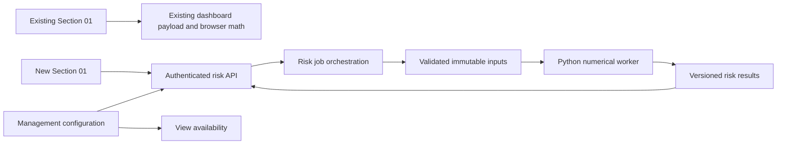

# Velovest Section 01: existing risk view and new model view

Date: 2026-10-16
Status: Initial conditional implementation added on `main`; disabled by default, not deployed. See [implementation and runtime notes](../../services/options-risk/README.md) for supported inputs, verification and deferred delivery stages.
Source branch: `main`.
Related research: [Options risk, strategy, and simulation](../deep-research-options-risk-strategy-simulation.md).

## 1. Decision and feasibility

**Feasible.** Add a second view inside dashboard Section 01, controlled by a management setting. Preserve the existing view and its model. Give the new view a separate backend calculation path and independent loading/error state.

The UI/configuration portion fits existing application patterns. Numerical risk and simulation remain a substantive backend addition with data prerequisites. Shipping a view selector alone does not deliver the new model.

Product contract:

- Section 01 has two selectable views when enabled: **Expiry & assignment** (existing) and **Risk & scenarios** (new).
- With the setting disabled or absent, users see the current Section 01 without an extra selector or model request.
- Initial selection on each page load remains the existing view, even when the new view is enabled.
- The existing probability calculation, thresholds, cards, search, filters, sorting, and discussion behavior retain their semantics.
- Section 03's Open/History/Rolls navigation and its `option_view` setting remain independent.
- New numerical outputs never overwrite books, historical accounting, existing probability quotes, or the existing view's calculated fields.

This supersedes the earlier evaluation's suggestion to replace/move the existing dashboard probability calculation. The user specifically requests coexistence.

## 2. Verified integration points

| File | Observed responsibility | Planned use |
|---|---|---|
| `src/webapp/dashboard-config.ts` | `invage-dashboard` management definition and camelCase response projection | Add one boolean field and response property |
| `src/extension.ts` | Registers `managementConfig: dashboardConfig` | Reuse current registration |
| `src/webapp/dashboard-api.ts` | Authenticated domain router, target-user resolution, dashboard caching/progress | Mount risk routes and advertise view availability |
| `webui/dashboard/index.html` | `expiryBlock`, `expiryTitle`, `expiryLead`, `expiryRow`, `expiryTable` | Wrap existing content and add sibling panel/selector |
| `webui/dashboard/app.js` | `renderExpiryRisk`, `optionFinishItmProbability`, view/channel/date state, discussion flow | Minimal orchestration hooks; preserve existing math |
| `src/market/fetch-option-marks.ts` | Matched option/underlying quote evidence | Existing view remains on its current input path |
| `src/market/types.ts` | `OptionSpec` and holdings conventions | Normalize into a richer risk-only contract schema |
| `src/tools/index.ts` | OptionsExpert read-only tools | Later expose retrieval of computed risk results |
| `tests/option-probability-quotes.test.ts` | Existing model and quote-matching checks | Regression anchor |
| `tests/dashboard-views.test.ts` | Management configuration and browser testing patterns | Extend for visibility and navigation |

Important implementation detail: `renderExpiryRisk` also participates in rendering other dashboard sections. Do not return early from that function merely because the new tab is selected. Keep its existing downstream render calls, or extract orchestration only with regression coverage.

Current Section 01 includes short contracts above 30% modeled ITM probability **or** confirmed ITM contracts within 21 days. Preserve that exception, not merely a description of a 30% filter. Existing zero-rate/no-dividend Black–Scholes math stays intact.

## 3. Management control

Add to Management → Agent Configuration → Portfolio dashboard:

```ts
{
  id: 'show_option_risk_model_view',
  type: 'boolean',
  label: 'Show Risk & scenarios view in Section 01',
  default: false,
  description:
    'Adds a second options risk view. The existing expiry and assignment view remains available.'
}
```

Expose through `readDashboardConfig()`:

```ts
showOptionRiskModelView: config.show_option_risk_model_view === true
```

Scope: deployment-wide agent configuration, following the existing management definition; not a per-investor preference. Configuration writes continue through the framework's existing management authorization. Verify those permissions during implementation rather than introducing a parallel settings endpoint.

Use effective availability:

```text
effectiveEnabled = showOptionRiskModelView && productProfile == consultant
```

The first release targets Velovest's consultant profile. Other profiles retain existing behavior; extending availability later is a separate explicit change. Do not condition on a mutable display name.

Default false makes older configuration files compatible without a data migration. Do not add a second default-view control in this release. Only literal boolean true enables the feature.

### Change propagation

- Saving the setting takes effect on subsequent server requests without an application restart, using the current read-on-use configuration pattern.
- Newly opened/refreshed dashboards receive the setting through their dashboard payload.
- Add a lightweight `GET /option-risk/capabilities` endpoint for open pages. Check when the browser tab regains focus and every 60 seconds while visible; do not invoke market providers or workers from this endpoint.
- A disabled response hides the selector/new panel, switches to the existing view, clears in-memory risk output, and stops polling. It must not reload all market data.
- Every risk job submission and result read rechecks the setting server-side. Hiding the tab alone is insufficient.
- Immediate removal from an idle open browser is not guaranteed; the designed propagation bound is 60 seconds for a visible page. Server enforcement is immediate on the next request.

Disabling this feature does not stop unrelated scheduled tasks or alter account data. A running dashboard risk job may finish internally, but its result cannot be served while disabled; queued dashboard risk jobs should be cancelled or skipped.

## 4. Section 01 user experience

Layout when enabled:

```text
Section 01
[ Expiry & assignment ] [ Risk & scenarios ]

Existing panel: current title, cards, filters, table and Discuss controls

OR

Risk & scenarios
As of ... · Account ... · Model ... · Coverage ...
[1 day] [5 trading days] [21 trading days]    [Run analysis / Recalculate]
[Stress loss] [Assignment funding] [Delta exposure] [Expected shortfall*]
Scenario results | Risk contributors | Possible actions
* Only populated when validated forecast inputs are available
```

Use `section01View = 'existing' | 'risk'`, separate from Section 03's `optionTab`. Keep selection in memory for the page session; reload starts on existing. Preserve each panel's filters when switching. New right/underlying filters must not mutate `riskSearch` or `riskRightFilter` belonging to the current renderer.

Proposed DOM IDs: `section01ViewTabs`, `section01ExistingTab`, `section01RiskTab`, `section01ExistingPanel`, `section01RiskPanel`. Retain existing child IDs. Use accessible tabs (`role=tablist/tab/tabpanel`, selected state, associated labels, arrow/Home/End key navigation). Hidden panels must not retain keyboard focus; when disabled, move focus to a visible control.

Clicking the new tab loads the latest compatible result or starts an idempotent analysis job. Tab switches alone never refresh legacy market data. Recalculate explicitly requests fresh validated inputs, while preserving the old result with a stale label until replacement is ready.

### Scope and coverage

The new model evaluates **long and short options together with relevant underlying shares and account cash**, not only the existing radar's flagged shorts. State that scope in the view. Standalone option risk and combined hedged-portfolio risk must be separately named.

Follow the selected account/channel. For combined accounts, aggregate P/L only with compatible currency valuation; report assignment funding per account because cash and shares in another broker are not automatically transferable collateral. Missing cash is unknown, never zero.

Display supported/total contract counts, excluded contract identifiers/reasons, quote age, and holdings revision. A partial calculation is labeled “Covered positions only,” never total portfolio risk. Include both contract count and absolute contract quantity; do not produce a misleading percentage using offsetting signed values.

When there are no option positions, preserve the current Section 01 hidden behavior. Long-only option portfolios still support the new view even though the existing view has no short-option rows.

### UI state machine

| State | Display / behavior |
|---|---|
| Disabled | Existing view only; no risk requests/jobs |
| Idle | New panel available, no result yet |
| Queued/running | Progress within new panel; existing panel remains usable |
| Ready | Results with model, input timestamps, scope, assumptions |
| Partial | Supported results plus exclusions; suppress unsupported totals |
| Unavailable | Missing-data/model reason and retry action; no fabricated metrics |
| Failed | Retryable error; keep legacy view working |
| Stale | Previous result clearly marked; recalculate offered |
| Archived date | Only matching saved result, otherwise “No saved risk analysis for this date” |

Never substitute current quotes into a historical dashboard view. Initial implementation computes only live analyses. Historical support means retrieval of an already saved matching analysis, not retrospective fitting using today's information.

## 5. What the new model delivers

Use the research design, with explicit capability levels rather than pretending all inputs already exist.

### Level A: deterministic risk and conditional scenarios

- Dividend-aware American option pricing and numerical Greeks.
- Exact expiry payoff bounds for supported structures.
- Full repricing for explicit spot, IV, and time shocks.
- Account-specific cash/share obligations and assignment branches.
- Compare hold, close, and eligible defined-risk hedges using observed quotes and stated scenario assumptions.

Label results “Conditional scenario,” without attaching forecast probabilities. A -10% spot / +10 volatility-point move is a stress assumption, not an estimated percentile. Basic hold/close comparisons can ship here; hedge selection requires fresh multi-leg quotes.

### Level B: validated probabilistic risk

- Filtered historical simulation with synchronized cross-asset shocks.
- Joint underlying/IV dynamics where historical surface data supports them.
- Horizon-specific VaR/ES, estimated probability of profit, and uncertainty.
- Strategy ranking against no trade/hold/close after costs and funding constraints.

GJR-GARCH is a validated challenger/filter; Heston remains a later extension. Lack of historical IV dynamics blocks calibrated interim option-P/L probabilities, but not conditional stress scenarios. Publish capability flags in results so the UI knows which sections are available.

### Numerical definitions

`scenarioPnl` is ending net liquidation wealth minus starting wealth, including entry/exit costs, dividends, exercise cash and delivered stock exactly once. Display losses with an explicit sign convention; distinguish positive loss magnitude from signed P/L.

Greeks include units: dollar delta, vega per one volatility percentage point, theta per calendar day. ES includes confidence level, horizon, model, and sampling uncertainty. Assignment cash is gross funding need, not expected loss. Do not reuse the existing view's “probability-weighted exposure” label for ES.

Compute aggregate scenario loss directly. Do not add standalone ES values. For initial contributor tables use marginal stress P/L or delta/vega exposure, with clear labels; additive ES attribution is deferred until implemented correctly.

## 6. Backend and data architecture



Keep heavy work outside Express's event loop and outside `/dashboard` loading. Python uses pinned QuantLib/numerical dependencies; Node performs authentication, authorization, input normalization and result delivery. Use a local worker process or loopback-only service with bounded requests; never spawn one process per individual option. No broker secrets need to reach the numerical worker.

Add a persistent job/result repository, preferably PostgreSQL to fit the existing host. Define a dedicated migration when implementing it; do not repurpose financial-state records or the existing preview cache as a durable job queue. Use lease-based claims, bounded retries, worker heartbeat, restart recovery, and maximum runtime. No automatic retry for invalid financial inputs.

Initial operational budgets, to benchmark rather than promise: one active job per investor, a small deployment-wide worker pool, a 60-second interactive job deadline, and strict contract/path/grid limits. Return “queued” promptly. Size the pool after measuring the actual deployment's CPU/RAM; that host capacity was not inspected for this design.

### Immutable inputs

Build inputs server-side from authorized holdings and market snapshots. Extend a risk-only contract DTO with stable ID, exercise style, exact expiry/timezone, deliverable, rate/dividend references and quote provenance. Preserve source premium units; convert dollars per contract to per-share pricing units exactly once.

Key each result by:

```text
tenant/deployment + target user + account scope + holdings revision
+ market snapshot ID + contract metadata version + FX snapshot
+ model/calibration version + scenario/horizon config + engine version
```

Persist sanitized inputs or references sufficient for reproducibility, seed, timestamps, exclusions, and numerical convergence diagnostics. Private portfolio payloads must not appear in shared logs. TTL and explicit user deletion apply to stored inputs/results; proposed default retention is 30 days, pending product retention requirements.

The existing dashboard does not expose all immutable-input identifiers needed here. Add an opaque `analysisContextId` describing the authorized portfolio revision, displayed account scope, and dashboard generation. A new job can collect its own fresh market snapshot; report its timestamps independently rather than claiming it uses exactly the legacy probability quotes. Reject mismatched portfolio context with 409 and ask the client to refresh.

## 7. Proposed API contract

All paths below are relative to `/api/domain/invage`. Reuse `AuthUser`, server-side target-user resolution and the existing session security conventions. Do not accept a caller-supplied user ID as authorization.

| Method/path | Purpose |
|---|---|
| `GET /option-risk/capabilities` | Cheap effective feature/config and supported capabilities |
| `POST /option-risk/jobs` | Validate scope/context, deduplicate or enqueue a live analysis |
| `GET /option-risk/jobs/:id` | Authorized progress and result status |
| `GET /option-risk/results/:id` | Authorized immutable result while feature enabled |
| `GET /option-risk/latest` | Retrieve result matching authorized scope/context; no calculation |

Example submission:

```json
{
  "analysisContextId": "opaque-context",
  "accountScope": { "kind": "selected", "accountIds": ["opaque-account"] },
  "horizonTradingDays": 5,
  "scenarioSet": "equity-options-standard-v1",
  "mode": "conditional",
  "refresh": false
}
```

The server validates account ownership, supported horizon/scenario enum, maximum universe, and revision. Reject arbitrary executable formulas, unbounded simulations, unknown fields and caller-provided authoritative valuations. POST follows framework CSRF/origin protections; verify the actual middleware before implementation.

Use 200 for reusable ready results, 202 for queued/running jobs, 400 for invalid input, 401 for no session, 404 for disabled feature or inaccessible job/result, 409 for stale context, 429 for rate limits, and 503 for worker unavailable. Financial data insufficiency returns a structured `unavailable` result, not a server crash.

Results should carry:

```ts
type RiskAnalysis = {
  id: string;
  status: 'ready' | 'partial' | 'unavailable';
  analysisContextId: string;
  portfolioRevision: string;
  generatedAt: string;
  marketAsOf: string;
  model: { id: string; version: string; measure: 'conditional' | 'physical' };
  scope: { accountIds: string[]; currency: string; horizonTradingDays: number };
  capabilities: { stress: boolean; greeks: boolean; forecast: boolean; actions: boolean };
  coverage: { totalContracts: number; supportedContracts: number; exclusions: unknown[] };
  metrics: Record<string, { value: number | null; unit: string; reason?: string }>;
  scenarios: unknown[];
  contributors: unknown[];
  actions: unknown[];
  assumptions: string[];
};
```

This is an illustrative envelope. Replace `unknown`/generic records with discriminated schemas before coding endpoints. Encode unlimited payoff loss explicitly, never JSON Infinity. Financial decimal/unit conventions should follow repository conventions; finite floating-point model outputs must include currency/unit metadata.

Cache freshness policy is separate from immutable result identity. A compatible old result may be shown as stale, but never silently treated as live. Both job submission and result read recheck effective configuration and user authorization. Return `Cache-Control: private, no-store` on browser API responses.

## 8. Frontend lifecycle and failure isolation

Implement new UI logic in `webui/dashboard/option-risk.js`; keep `app.js` changes limited to initialization, scope updates and the view selector. Give the new module its own CSS namespace and event handlers.

- Fetch/compute lazily on first activation.
- Poll jobs at a bounded interval (proposed two seconds with backoff), only while the new panel is visible. Resume retrieval on re-entry.
- Use AbortController plus an incrementing context generation. Drop responses from prior account/date/portfolio selections even if cancellation arrives too late.
- On scope change, clear incompatible output immediately; a late response must never populate another account's view.
- Switching away stops browser polling; shared jobs can finish and cache their results.
- Dashboard refresh invalidates the analysis context as appropriate; it must not automatically start a costly job if the existing view is selected.
- Failure of new JS loading, worker timeout, bad calibration or unavailable data must leave the existing view functional.

Keep feature configuration available before showing a selector. Never briefly display the new panel from stale browser state when the current configuration is unknown.

A saved/static report lacking authenticated API context shows existing content only, unless a future export explicitly embeds a sanitized immutable risk result. Do not issue authenticated risk requests from arbitrary report previews.

## 9. Discuss and strategy explanations

Reuse the existing side-chat experience, but send the risk result ID and user-visible context. Add a read-only OptionsExpert result-retrieval tool with the same ownership checks. Retrieve trusted server-side results before making numerical claims; browser prompt text is not the source of truth.

A discussion includes account/scope, holdings revision, model version, as-of time, horizon, assumptions, exclusions and the chosen scenario/action. If data has become stale, state that before offering a fresh analysis. The existing Discuss behavior remains unchanged.

Level A suggestions explain conditional risk changes, such as a hedge reducing loss in the selected stress. Level B may rank calibrated outcomes. Neither level executes trades, changes positions, or represents a roll credit as recovered profit.

## 10. Implementation file plan

| Area | Proposed changes |
|---|---|
| Configuration | Extend `src/webapp/dashboard-config.ts`; reuse management registration |
| Existing dashboard response | Add effective capability flag and opaque analysis context, without model output |
| API | Add `src/webapp/option-risk-api.ts`, mount through current authorized router |
| Service | Add `src/risk/` normalization, schemas, orchestration, limits, result repository |
| Worker | Add `services/options-risk/` pinned Python service, model tests, environment definition |
| Database | Dedicated job/result migration using established project migration mechanism after inspection |
| Frontend | Extend `index.html`, add `option-risk.js` and scoped styles, small `app.js` hooks |
| Agent | Add authorized result-reading tool and targeted OptionsExpert instructions |
| Tests | Config, API authorization, numerical engine, lifecycle, browser regression suites |

No framework fork is expected for the configuration field itself. Validate the current installed framework's management renderer and authorization in the implementation spike.

## 11. Verification and acceptance criteria

### Existing behavior preservation

- Existing model returns identical results for fixed quote fixtures before/after the feature.
- Current quote matching, missing-price reasons, thresholds, 21-day ITM inclusion, sort order and card formulas remain identical.
- Existing search, right filter, highlighting, Discuss, account selection and Section 02/03 rendering still work.
- With the flag false/absent, no new risk job or market-data request occurs.

### Configuration and navigation

- Management exposes one boolean, saved and reread without restart.
- Missing/false configuration shows one view; true consultant configuration shows two; true full-profile configuration remains unavailable.
- Existing view is selected on load. Switching preserves panel-local state.
- Disabling while the new panel is open returns to existing on the next capability check; direct API requests are blocked immediately.
- Desktop/mobile layout, keyboard navigation, focus behavior and screen-reader states pass browser tests.

### API, concurrency and isolation

- Cross-user/account job and result access fails, including guessed IDs.
- Duplicate submissions share work; context changes reject stale revisions.
- Delayed results after account/date changes never render in the new context.
- Timeouts, worker restart, malformed output and capacity limits have bounded recovery.
- Archive dates cannot launch live computations; static reports cannot trigger private API work.
- Incognito/session-only states follow existing retention semantics; until verified, disable persistent risk jobs in that mode with an explicit reason.

### Numerical and data validation

Use the research document's pricing, lifecycle and forecast validation gates. Include per-share/per-contract units, short signs, discrete dividends, partial assignment, long/short spread legs, currency gaps and missing cash. Unsupported instruments produce exclusions. Probability metrics remain unavailable until calibrated physical forecasts pass validation; deterministic scenarios can ship independently.

Performance acceptance: legacy dashboard latency and payload size should not materially regress with feature disabled. Benchmark current baseline and set a budget before merging; new analysis loading must never block legacy rendering.

## 12. Delivery stages and rollout

1. **Compatibility shell:** config field, hidden-by-default selector, independent panel state, mocked API/browser tests. Keep off in production; this is not completion of the risk capability.
2. **Usable model view:** validated Level A pricer, scenarios, funding, coverage, real API and durable job handling. Enable only after real supported inputs produce meaningful results.
3. **Action comparisons:** hold/close and quoted defined-risk hedges; result-backed discussion.
4. **Probabilistic extension:** historical market data, FHS and calibration report; then ES/forecast/action-ranking sections become available.

Rollback begins by disabling `show_option_risk_model_view`. Existing Section 01 continues serving its current model. A backend rollback must retain compatibility with stored result versions or refuse unsupported versions explicitly.

For future implementation/deployment, select an existing branch for that task, commit all changes, verify a clean deployment source, and deploy the exact committed version using the applicable agent deployment workflow. This document authorizes no production change.

## 13. Remaining decisions and conclusion

Defaults selected here avoid blocking the requested design: consultant-only availability, deployment-wide boolean, disabled by default, existing view first, live-only computation, and staged model capabilities. These can be revised before implementation.

Implementation still needs a market-data provider/sample assessment, actual host resource benchmark, numerical-worker packaging decision, database migration review, and agreed forecast validation thresholds. None prevents the dual-view design; they determine when the new model can provide reliable metrics.

**Recommended outcome:** preserve the existing Section 01 as a stable view and add an independently computed Risk & scenarios view behind the management toggle. Ship real conditional risk analysis first, then enable probability-based analytics only as their data and validation become ready.
